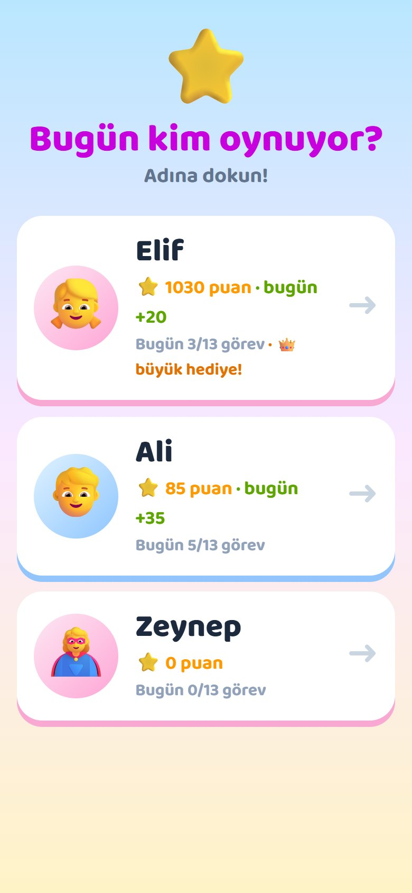
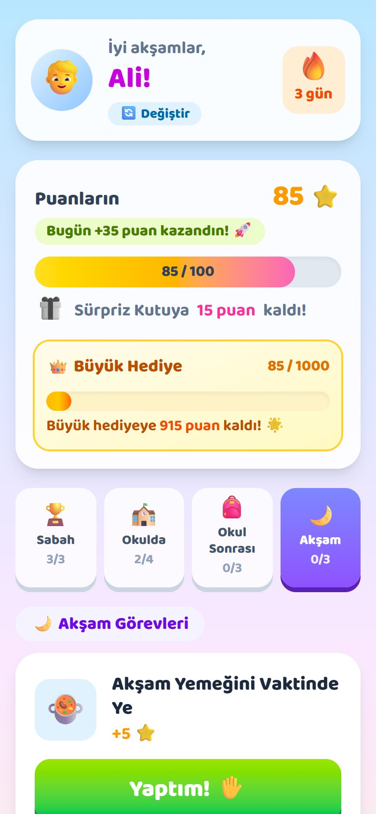
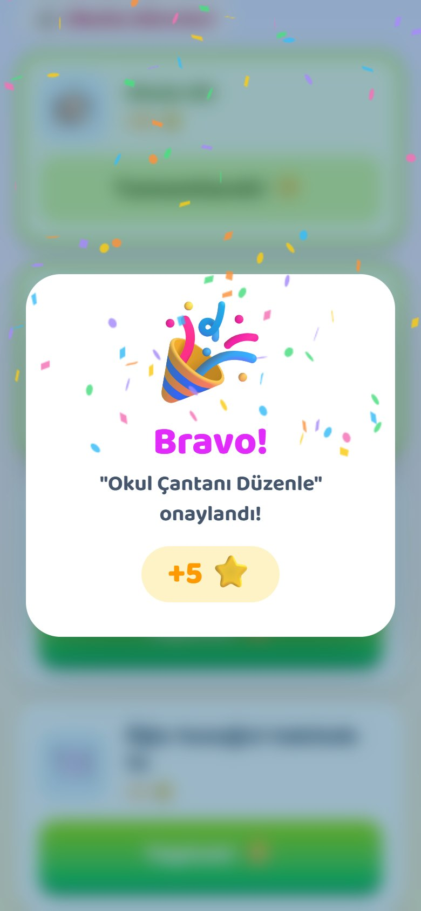
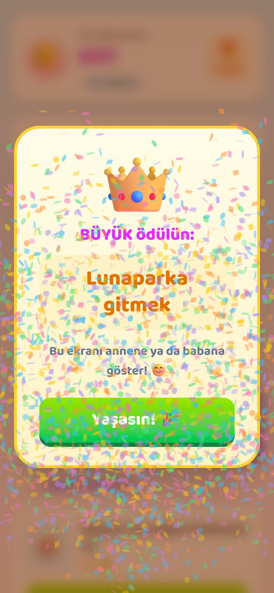
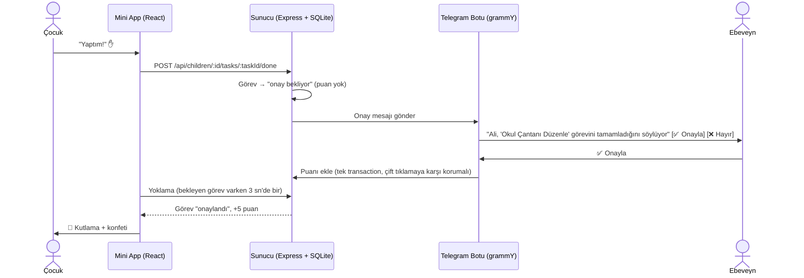

# 🌱 KaizenKids

**Her gün %1 daha iyi!** — 7–9 yaş arası çocukların günlük alışkanlıklar kazanmasını oyuna dönüştüren bir **Telegram Mini App** ve ebeveyn botu.

Çocuk görevini yapınca uygulamada **"Yaptım!"** der → ebeveyne Telegram'dan **✅ Onayla / ❌ Hayır** butonlu mesaj gider → ebeveyn onaylarsa puan eklenir ve çocuğun ekranında konfetili kutlama çıkar → her **100 puanda 🎁 Sürpriz Kutu**, her **1000 puanda 👑 Büyük Hediye** açılır. Kutulardan çıkan gerçek dünya ödüllerini ebeveyn kendisi yazar.

<p align="center">
  
  
  
  
</p>

> 📘 **Ebeveynler için görselli kullanım ve tanıtım rehberi:** [docs/KaizenKids-Rehber.pdf](docs/KaizenKids-Rehber.pdf)

---

## İçindekiler

- [Özellikler](#özellikler)
- [Nasıl çalışır?](#nasıl-çalışır)
- [Teknolojiler](#teknolojiler)
- [Hızlı başlangıç](#hızlı-başlangıç)
- [Ortam değişkenleri](#ortam-değişkenleri)
- [Çalıştırma yolları](#çalıştırma-yolları)
- [Bot komutları](#bot-komutları)
- [Görevler ve puanlar](#görevler-ve-puanlar)
- [Proje yapısı](#proje-yapısı)
- [API](#api)
- [Veritabanı ve migration'lar](#veritabanı-ve-migrationlar)
- [Güvenlik](#güvenlik)
- [Sorun giderme](#sorun-giderme)
- [Bilinen sınırlamalar](#bilinen-sınırlamalar)

## Özellikler

| | |
|---|---|
| ✋ **Ebeveyn onaylı görevler** | Puan, çocuk "Yaptım!" dediğinde değil ebeveyn onayladığında verilir. Reddedilen görev "Tekrar Dene" olarak döner. |
| 👦👧 **Birden çok çocuk** | Tek Telegram hesabıyla en fazla 6 çocuk. Puan, seri ve kutular çocuk başına ayrı; uygulama her açılışta "Bugün kim oynuyor?" diye sorar. |
| 🗓️ **Günün bölümleri** | Sabah · Okulda · Okul Sonrası · Akşam; saate göre doğru sekme açılır, hafta sonu okul görevleri gizlenir. |
| ⭐ **Puan, seri, günlük puan** | Toplam puan, bugün kazanılan puan ve art arda görev yapılan gün sayısı (🔥 seri). |
| 🎁 **Sürpriz Kutu** / 👑 **Büyük Hediye** | Her 100 / 1000 puanda bir kutu; içindeki hediyeleri ebeveyn `/hediyeler` ile adım adım yazar (liste başına 5 önerilir, en fazla 10). Art arda aynı hediye çıkmaz. |
| 🎉 **Anında geri bildirim** | Ebeveyn onayladığında çocuğun ekranında konfetili kutlama; dokunsal titreşim. |
| 🔐 **Güvenli kimlik doğrulama** | Telegram `initData` HMAC imzası sunucuda doğrulanır; her ebeveyn yalnızca kendi çocuklarını görür. |
| 💻 **Ücretsiz barındırma** | Kendi bilgisayarında, otomatik başlayan ve çökünce kendini toparlayan betik + ücretsiz Cloudflare tüneli. |

## Nasıl çalışır?



## Teknolojiler

| Katman | Kullanılan |
|---|---|
| Mini App | React 19, Vite, TypeScript, Tailwind CSS v4, `@twa-dev/sdk`, `canvas-confetti` |
| Bot | Node.js 22+, TypeScript, [grammY](https://grammy.dev) (long polling) |
| API | Express 5 |
| Veritabanı | SQLite — `better-sqlite3` (WAL), sürüm tabanlı migration'lar |
| Barındırma | Kendi bilgisayarı + Cloudflare Quick Tunnel (ücretsiz) veya herhangi bir Node sunucusu |

Monorepo, npm workspaces ile yönetilir (`apps/server`, `apps/web`).

## Hızlı başlangıç

### Gereksinimler

- **Node.js 22 veya üzeri** (`node -v`)
- **Telegram bot token'ı** — Telegram'da [@BotFather](https://t.me/BotFather) → `/newbot`
- **HTTPS adresi** — Telegram, Mini App'i yalnızca HTTPS ile açar. Ücretsiz seçenek: [cloudflared](https://github.com/cloudflare/cloudflared/releases/latest) (hesap gerekmez)

### Kurulum

1. Depoyu klonlayın ve bağımlılıkları kurun:
   ```bash
   git clone https://github.com/fazliddin-hamdam/kaizenkids.git
   ```
   ```bash
   cd kaizenkids
   ```
   ```bash
   npm install
   ```
2. Ortam dosyasını oluşturun ve en azından `BOT_TOKEN` değerini yazın:
   ```bash
   cp .env.example .env
   ```
   > Windows PowerShell'de: `Copy-Item .env.example .env`
3. Bir HTTPS tüneli açın (ayrı bir terminalde) ve verdiği `https://…trycloudflare.com` adresini `.env` içine `WEBAPP_URL` olarak yazın:
   ```bash
   cloudflared tunnel --url http://localhost:5173
   ```
4. Geliştirme modunda başlatın (bot + API + Vite birlikte):
   ```bash
   npm run dev
   ```
5. Telegram'da botunuza `/start` yazın, `/isim Ali` ile bir çocuk ekleyin, `/hediyeler` ile hediyeleri yazın ve sohbetin altındaki **KaizenKids** menü butonuyla uygulamayı açın.

> 💡 Sürekli çalışan bir kurulum için tünel adresini elle yazmanız gerekmez: [Kendi bilgisayarında sürekli çalıştırma](#3-kendi-bilgisayarında-sürekli-çalıştırma-ücretsiz).

## Ortam değişkenleri

Tümü kökteki `.env` dosyasında tutulur (şablon: [.env.example](.env.example)). **`.env` asla commit edilmez.**

| Değişken | Varsayılan | Açıklama |
|---|---|---|
| `BOT_TOKEN` | — (zorunlu) | @BotFather'dan alınan token. Gizli tutun. |
| `WEBAPP_URL` | — | Mini App'in **HTTPS** adresi. Bot menü butonu ve `/start` butonu bunu kullanır. |
| `PORT` | `3000` | API (ve üretimde Mini App) portu. |
| `DB_PATH` | `data/kaizenkids.db` | SQLite dosyası (kök dizine göre). |
| `APP_TIMEZONE` | `Europe/Istanbul` | "Bugün" ve gün bölümü bu saat dilimine göre hesaplanır. |
| `BOX_THRESHOLD` | `100` | Sürpriz Kutu için gereken puan. |
| `BIG_BOX_THRESHOLD` | `1000` | Büyük Hediye için gereken toplam puan. |
| `DEV_AUTH_BYPASS` | `false` | Yalnızca geliştirme: `true` ise Telegram dışından açılan uygulama `DEV_USER_ID` sayılır. **Sadece bu bilgisayardan (localhost) gelen isteklerde** çalışır; üretimde (`NODE_ENV=production`) tamamen kapalıdır. |
| `DEV_USER_ID` | `0` | Geliştirici kestirmesinde kullanılacak kendi Telegram ID'niz. |

## Çalıştırma yolları

### 1) Geliştirme

```bash
npm run dev
```

Vite (5173) ve API (3000) birlikte çalışır; Vite `/api` isteklerini API'ye yönlendirir. Tünel `5173`'e bakmalıdır.

### 2) Telegram dışında, tarayıcıda denemek

`.env` içinde `DEV_AUTH_BYPASS=true` ve `DEV_USER_ID=<kendi Telegram ID'niz>` yapıp `http://localhost:5173` adresini açın. Onay mesajları bu ID'ye gider (önce bota `/start` yazmış olmalısınız). Telegram ID'nizi [@userinfobot](https://t.me/userinfobot) söyler.

### 3) Kendi bilgisayarında sürekli çalıştırma (ücretsiz)

Proje köküne `cloudflared.exe` koyun (Windows). Ardından:

| Komut | Ne yapar |
|---|---|
| `npm run local:install` | Windows oturumu açılınca arka planda (pencere açmadan) otomatik başlatır + şimdi başlatır |
| `npm run local:status` | Çalışıyor mu, güncel tünel adresi ne? |
| `npm run local:stop` | Durdurur (`npm run dev` öncesi gerekli — aynı bot iki yerde çalışamaz) |
| `npm run local:start` | Ön planda başlatır |
| `npm run local:uninstall` | Otomatik başlatmayı kaldırır ve durdurur |

[scripts/local-server.mjs](scripts/local-server.mjs) uygulamayı üretim modunda derler, ücretsiz tüneli açar, **her açılışta değişen tünel adresini** `WEBAPP_URL` olarak sunucuya verir; sunucu da bot menü butonunu her ebeveyn sohbetinde günceller. Tünel ya da sunucu çökerse ikisini birden yeniden başlatır. Kayıtlar `logs/kaizenkids.log` dosyasındadır. Bilgisayar kapalıyken veya uykudayken bot çalışmaz.

### 4) Bir sunucuda (üretim)

```bash
npm run build
```
```bash
NODE_ENV=production npm start
```

Express, derlenmiş Mini App'i (`apps/web/dist`) API ile aynı porttan sunar. `WEBAPP_URL`'i sunucunuzun HTTPS adresi yapın ve `data/` klasörünü kalıcı bir diskte tutun.

## Bot komutları

**Çocuklar**

| Komut | Açıklama |
|---|---|
| `/start` | Karşılama, çocuk listesi ve uygulamayı açma butonu |
| `/isim Ali` | Çocuk ekler ve cinsiyetini sorar (👦 Erkek / 👧 Kız). Kısa yol: `/isim Ayşe kız` |
| `/cinsiyet 1` | 1. çocuğun cinsiyetini seçer/değiştirir (avatar buna göre verilir) |
| `/cocuklar` | Çocukları listeler |
| `/isimdegistir 2 Elif` | 2. çocuğun adını değiştirir |
| `/cocuksil 2` | 2. çocuğu listeden kaldırır (veriler saklanır; aynı adla `/isim` yazılınca geri gelir) |

**Takip**

| Komut | Açıklama |
|---|---|
| `/durum` | Tüm çocukların bugünkü özeti ve onay bekleyen görevler |
| `/durum 1` | 1. çocuğun ayrıntılı görev listesi, puanı, serisi ve kutuları |

**Hediyeler** (ebeveyn yazar; aile için ortak liste)

| Komut | Açıklama |
|---|---|
| `/hediyeler` | İki liste, sayaçlar (x/5), nasıl yazılır, örnekler ve **ekle** butonları. Butona basınca bot soru sorar; ebeveyn mesajı yanıtlayarak yazar, 5'e ulaşana kadar bir sonraki istenir. |
| `/oduller` · `/odulekle …` · `/odulsil 2` | 🎁 Sürpriz Kutu listesi. `/odulekle` çok satırlı yazılabilir (her satır bir hediye); tek başına yazılırsa adım adım sorar. |
| `/buyukoduller` · `/buyukodulekle …` · `/buyukodulsil 2` | 👑 Büyük Hediye listesi (aynı kurallar) |
| `/yardim` | Tüm komutlar |

## Görevler ve puanlar

Tam bir okul günü = **100 puan** (hafta sonu en fazla 70).

| Bölüm | Görevler | Puan |
|---|---|---|
| ☀️ Sabah | Yatağını Topla (5) · Dişlerini Fırçala (5) · Kahvaltını Vaktinde Yap (5) | 15 |
| 🏫 Okulda | Okula Git (10)\* · Dersleri İyi Dinle (10)\* · Okulda 5 Puan Al (Not/Yıldız) (10)\* · Öğle Yemeğini Vaktinde Ye (5) | 35 |
| 🎒 Okul Sonrası | Okul Çantanı Düzenle (5) · Ödevlerini Yap (15) · 15 Dakika Spor Yap (10) | 30 |
| 🌙 Akşam | Akşam Yemeğini Vaktinde Ye (5) · Oyuncaklarını Topla (5) · Erken Uyu (21:30) (10) | 20 |

\* Yalnızca hafta içi. Sekmeler saate göre açılır: 08:00'e kadar Sabah · 15:00'e kadar Okulda · 19:00'a kadar Okul Sonrası · sonrası Akşam.

**Görevleri değiştirmek:** [apps/server/src/db/schema.ts](apps/server/src/db/schema.ts) içindeki `SEED_TASKS` listesini düzenleyin. Sunucu açılışta listeyi veritabanına yansıtır; listeden çıkarılan görevler silinmez, pasif yapılır (geçmiş kayıtlar bozulmaz).

## Proje yapısı

```
kaizenkids/
├─ package.json                # npm workspaces + ortak komutlar (dev, build, local:*)
├─ .env.example                # ortam değişkenleri şablonu (gerçek değerler .env'de, commit edilmez)
├─ docs/
│  ├─ KaizenKids-Rehber.pdf    # ebeveynler için görselli kullanım ve tanıtım rehberi
│  └─ img/                     # ekran görüntüleri
├─ scripts/
│  ├─ local-server.mjs         # bilgisayarda sürekli çalıştırma: derle + tünel + sunucu + yeniden başlatma
│  └─ arka-planda-baslat.vbs   # Windows açılışında pencere açmadan başlatıcı
└─ apps/
   ├─ server/src/
   │  ├─ index.ts              # giriş: API + bot (long polling)
   │  ├─ config.ts             # .env okuma
   │  ├─ types.ts              # veritabanı satırları + API tipleri
   │  ├─ db/
   │  │  ├─ schema.ts          # şema, sabit görevler, avatarlar, hediye örnekleri
   │  │  ├─ index.ts           # bağlantı + sürüm tabanlı migration'lar + görev seed'i
   │  │  └─ repo.ts            # tüm sorgular (onay, puan, seri, kutu açma, çocuklar, hediyeler)
   │  ├─ bot/
   │  │  ├─ bot.ts             # Bot örneği, HTML kaçış
   │  │  ├─ handlers.ts        # /start, çocuk komutları, /durum, menü butonu
   │  │  └─ rewards.ts         # /hediyeler, adım adım hediye yazma, hatırlatmalar
   │  ├─ services/approval.ts  # "Yaptım!" → onay mesajı → ✅/❌ → puan; kutu bildirimleri
   │  ├─ api/
   │  │  ├─ auth.ts            # Telegram initData HMAC doğrulaması
   │  │  ├─ routes.ts          # /api/children… uç noktaları
   │  │  └─ app.ts             # Express (+ üretimde apps/web/dist)
   │  └─ utils/date.ts         # saat dilimi, okul günü, gün bölümü
   └─ web/src/
      ├─ App.tsx               # çocuk seçimi → panel
      ├─ lib/telegram.ts       # Telegram WebApp SDK (ready, expand, initData, titreşim)
      ├─ lib/api.ts            # `Authorization: tma <initData>` ile istekler
      ├─ hooks/useDashboard.ts # yoklama + onay/ret geçişlerini yakalama
      └─ components/           # ChildPicker, Dashboard, TaskCard, ProgressCard, PeriodTabs,
                               # SurpriseBoxModal, Celebration, Toast, SplashScreen
```

## API

Tüm uç noktalar `Authorization: tma <initData>` başlığı ister. Sunucu, istenen çocuğun isteği yapan ebeveyne ait olduğunu her istekte doğrular.

| Yöntem | Yol | Açıklama |
|---|---|---|
| `GET` | `/api/children` | Ailenin çocukları (seçim ekranı özeti) |
| `GET` | `/api/children/:childId/state` | Çocuğun paneli: görevler, puanlar, seri, kutular |
| `POST` | `/api/children/:childId/tasks/:taskId/done` | "Yaptım!" — ebeveyne onay mesajı gönderir |
| `POST` | `/api/children/:childId/box/open` | Kutu açar. Gövde: `{ "kind": "small" }` veya `{ "kind": "big" }` |
| `GET` | `/health` | Sağlık kontrolü (kimlik doğrulamasız) |

## Veritabanı ve migration'lar

| Tablo | Amaç |
|---|---|
| `families` | Ebeveyn (Telegram kullanıcısı) = aile |
| `children` | Çocuklar: ad, cinsiyet, avatar, toplam puan, açılan kutu sayıları |
| `tasks` | Sabit görevler (`school_days_only`, `is_active`) |
| `daily_logs` | Çocuk + görev + gün başına tek kayıt: `pending` / `approved` / `rejected` |
| `rewards` | Ebeveynin yazdığı hediyeler; `kind`: `small` (Sürpriz Kutu) / `big` (Büyük Hediye) |
| `reward_claims` | Açılan kutuların geçmişi |

Puanlar yalnızca ebeveyn onayında ve tek bir transaction içinde eklenir; aynı butona iki kez basmak çift puan vermez.

Şema değişiklikleri [apps/server/src/db/index.ts](apps/server/src/db/index.ts) içindeki `MIGRATIONS` listesine **sona eklenen** adımlarla yapılır; hangi adımda olunduğu `PRAGMA user_version`'da tutulur. Yeni veritabanı doğrudan güncel şemayla kurulur. Var olan bir migration adımını sonradan değiştirmeyin.

**Yedek:** Veriler `data/kaizenkids.db` dosyasındadır. Kopyalamadan önce botu durdurun (`npm run local:stop`) ya da SQLite yedekleme aracını kullanın.

## Güvenlik

- **Kimlik doğrulama:** Mini App'in gönderdiği `initData`, bot token'ından türetilen anahtarla HMAC-SHA256 ile sunucuda doğrulanır ([auth.ts](apps/server/src/api/auth.ts)); 24 saatten eski veriler reddedilir.
- **Yetkilendirme:** Her istek, çocuğun o ebeveyne ait olduğunu kontrol eder. Onay ve cinsiyet butonlarına yalnızca o çocuğun ebeveyni basabilir; başkasına iletilen mesajlar işe yaramaz.
- **Geliştirici kestirmesi:** `DEV_AUTH_BYPASS` yalnızca `localhost`'tan, yönlendirme başlığı (`X-Forwarded-For`, `CF-Connecting-IP`) taşımayan isteklerde çalışır; tünel üzerinden kullanılamaz ve üretimde kapalıdır.
- **Gizli bilgiler:** `BOT_TOKEN` yalnızca `.env` içinde durur. `.env`, `data/` (veritabanı ve yedekler), `logs/` ve `cloudflared.exe` `.gitignore` ile depo dışındadır.
- **Token sızarsa:** @BotFather → `/revoke` ile token'ı hemen iptal edip yenisini `.env`'e yazın.
- **Kişisel veri:** Veritabanında ebeveynin Telegram ID'si ve adı, çocukların adı ve görev geçmişi tutulur; veriler yalnızca sizin bilgisayarınızda/sunucunuzda kalır.

Güvenlik açığı bildirimi için: [SECURITY.md](SECURITY.md).

## Sorun giderme

| Belirti | Çözüm |
|---|---|
| Uygulama "Bu uygulama Telegram içinden açılmalı" diyor | Mini App'i **× ile kapatıp** bot sohbetinden yeniden açın. Sunucu kaydı (`logs/kaizenkids.log`) reddetme nedenini yazar. |
| Menü butonu eski adrese gidiyor | Sunucuyu yeniden başlatın; buton her açılışta tüm ebeveyn sohbetlerinde güncellenir. Eski `/start` mesajındaki buton eski adreste kalır — yeni buton için `/start` yazın. |
| `409 Conflict` / bot başlatılamadı | Aynı bot iki yerde çalışıyor. `npm run local:stop` ile arka plandakini durdurun. |
| "Annene/babana mesaj gönderilemedi" | Ebeveyn bota `/start` yazmamış ya da botu engellemiş. |
| Kutu "içi boş" diyor | Ebeveyn henüz hediye yazmamış: `/hediyeler`. Kutu kaybolmaz; hediye eklenince açılabilir. |
| Port 3000/5173 kullanımda | Başka bir kopya çalışıyor olabilir: `npm run local:status`, gerekirse `npm run local:stop`. |
| Bot geceleri yanıt vermiyor | Bilgisayar uykuya geçmiş olabilir. Windows Ayarlar → Sistem → Güç → Uyku: "Hiçbir zaman". |

## Bilinen sınırlamalar

- Ücretsiz Cloudflare tünelinin adresi her açılışta değişir ve çalışma garantisi yoktur; kalıcı kullanım için alan adlı bir tünel ya da sunucu önerilir.
- Resmî tatiller ve yaz tatili okul günü hesabına dahil değildir (yalnızca hafta sonu).
- Görev listesi tüm aileler için sabittir; hediye listeleri aile genelinde ortaktır.

## Lisans

© 2026 KaizenKids. **Tüm hakları saklıdır.**

Bu depo inceleme ve tanıtım amacıyla herkese açıktır. Kaynak kodu, görseller ve rehber, yazılı izin alınmadan kopyalanamaz, değiştirilerek dağıtılamaz veya ticari amaçla kullanılamaz. İş birliği ve kullanım izni için depo sahibiyle iletişime geçin.
